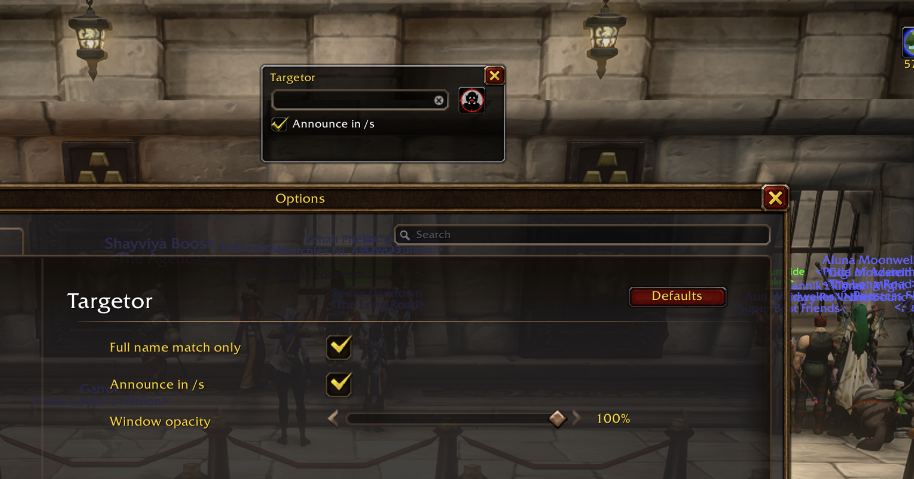
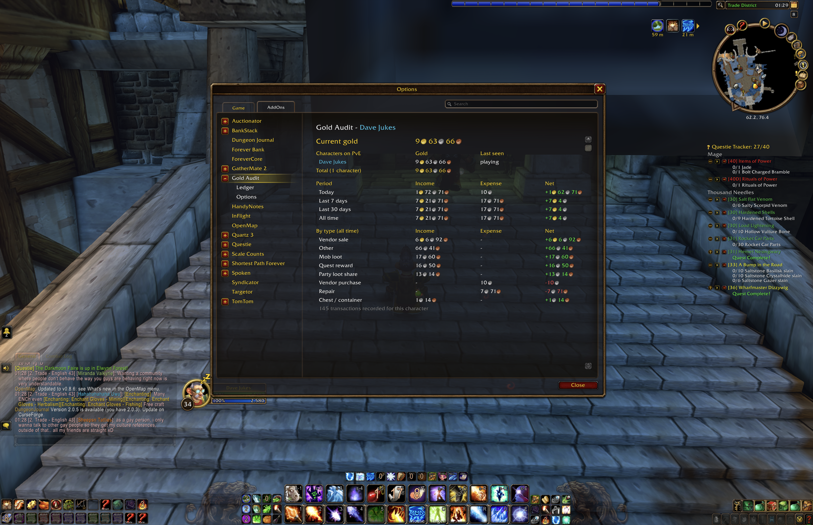
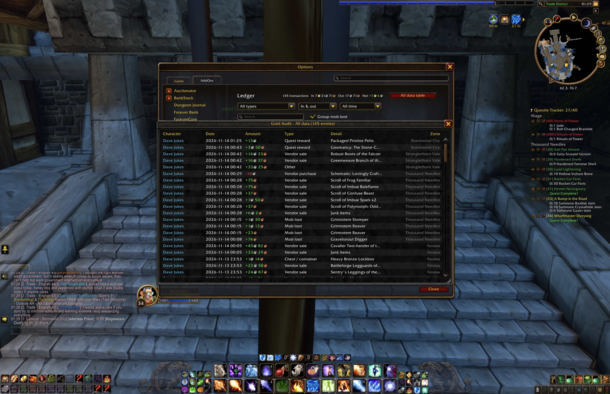
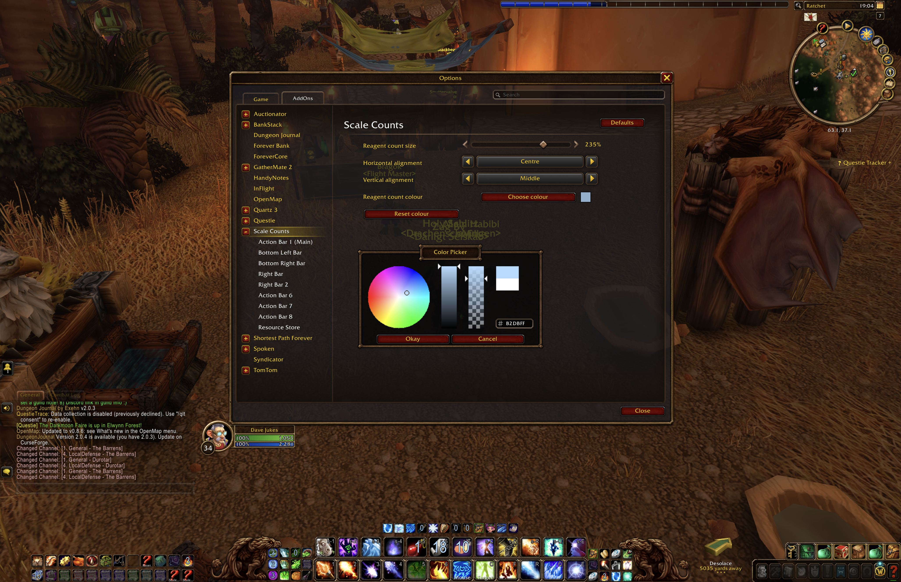
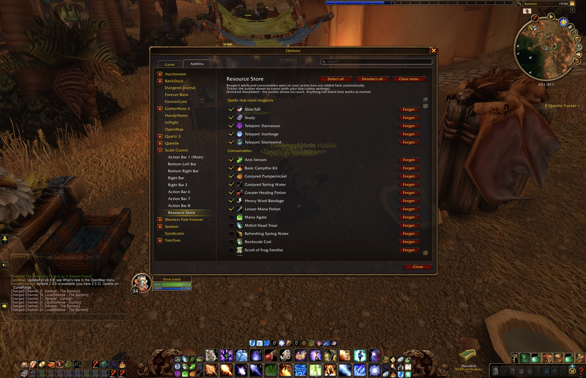

# Jukes Addons

Three small World of Warcraft addons for **Classic** clients.
They're built for and tested on the 1.x "Forever" client, and their `.toc` files also list other Classic and Retail interface versions.

| Addon | What it does |
| --- | --- |
| [**Targetor**](#targetor) | Type a name and click, or press your keybind, to `/target` it. Exact matches get the X marker and an optional `/s` announcement. |
| [**Gold Audit**](#gold-audit) | Records every change to your gold and what caused it, with a ledger, totals and filters. |
| [**Scale Counts**](#scale-counts) | Resizes, recolours and repositions the item/reagent count on action bar buttons. |

> [!WARNING]
> **Use at your own risk.** These addons are provided "as is", without warranty of any kind. See the [MIT License](LICENSE).

## Install

1. Download a zip from the [latest release](https://github.com/David-Tennant/JukesAddons/releases/latest). `JukesAddons-all` contains all three addons.
2. Extract it into `World of Warcraft/_<version>_/Interface/AddOns/`, so that you have, for example, `Interface/AddOns/JukesTargetor/JukesTargetor.toc`.
3. Restart the game, or `/reload` if it was already running, and check the addons are enabled in the AddOns list.

The folders are prefixed with `Jukes`, but the addons show in-game as **Targetor**, **Gold Audit** and **Scale Counts**.

---

## Targetor

A small window for finding a mob or player by name.

- Type a name and click the **target icon**. Targetor runs `/target <name>`.
- On a match it puts the **X** raid marker on the target, says `Found <Name>! {x}` in `/s`, and shows "Found" in the window.
- Click the **minimap button** to show or hide the window, and drag it to move it around the minimap. `/targetor` also toggles the window.
- The clear button empties the text box. The **Announce in /s** checkbox on the window turns announcing on or off.

**Keybind** (on the window):

1. Tick **Keybind**. The first time, the button next to it asks you to press a key.
2. Press any key, with Shift, Ctrl or Alt if you like (for example `SHIFT-F`). Pressing that key now does the same as clicking the target icon.
3. To change the key, click the button again and press a new one. Esc cancels.
4. Untick **Keybind** to give the key back whatever it did before.

While ticked, the Targetor keybind **overrides** that key's normal binding. Targetor never changes your saved key bindings: the override sits on top of them, and unticking removes it. Hover over the key button to see what the key normally does. The key and the on/off state are remembered between sessions.

**Settings** (Options → AddOns → Targetor):

| Setting | Default | |
| --- | --- | --- |
| Full name match only | On | Only exact name matches are marked and announced. When off, any partial match `/target` finds counts. |
| Announce in /s | On | The same setting as the checkbox on the window. |
| Use keybind | Off | The same setting as the **Keybind** checkbox on the window. Choose the key on the window. |
| Window opacity | 100% | Anywhere from 5% to 100%. |

**Limits set by the game:**
- **Click or keybind only:** addons can only target from a real mouse click or key press, so pressing Enter in the text box doesn't target. Use the keybind instead.
- **Combat:** during combat you can't change the name, show or hide the window, or turn the keybind on, off or to a new key. The button and the keybind still work with the name you set before. A keybind change asked for in combat applies as soon as combat ends.
- **Groups:** in a group, the X marker needs you to be leader or assist.
- **Your target:** each click clears your current target first, so an old target isn't reported as found.

---

## Gold Audit

Records every change to your gold and works out why it happened: quest rewards, mob loot, vendor sales, repairs, the auction house, mail, trades, flight paths, training and more.

Open it with **`/ga`**, or from Options → AddOns → Gold Audit.

- **Summary:** current gold, your characters' gold and when you last saw each, income/expense/net by period, and totals by type.
- **Ledger:** every transaction for the current character, filtered by type, in/out, time period and text search. Mob loot can be grouped into one expandable line. The totals at the top cover only the transactions shown.

  

- **All data window:** every transaction for **every character** in a window you can move and resize. Open it with the **All data table** button on the Ledger page, or with **`/ga data`**. Its size and position are remembered.

  

- **Time periods:** Today, Last 7 days, Last 30 days, All time, or **Custom range**. Custom range has separate **date** and **time** boxes for *From* and *To*, each with step arrows. They start at your earliest and latest recorded transactions.
- **Options:** print each change to chat, group mob loot, and delete this character's history.

---

## Scale Counts

Changes how the item and reagent count looks on action bar buttons, for example how many reagents you have left for a spell.

- **Size** from 50% to 300%, **colour and opacity**, and **position** (left/centre/right, top/middle/bottom).
- Set it once for all bars, or give individual bars their own settings.
- **Resource Store:** reagent spells and consumables seen on your bars are listed here. Untick one to hide its count, or click **Forget** to remove it from the list.

  

- Also applies to Bartender4, Dominos and ElvUI bars, using the all-bars settings.

Open it from Options → AddOns → Scale Counts, or with **`/scalecounts`** (or `/srt`).

---

## License

[MIT](LICENSE) © 2026 David Tennant
