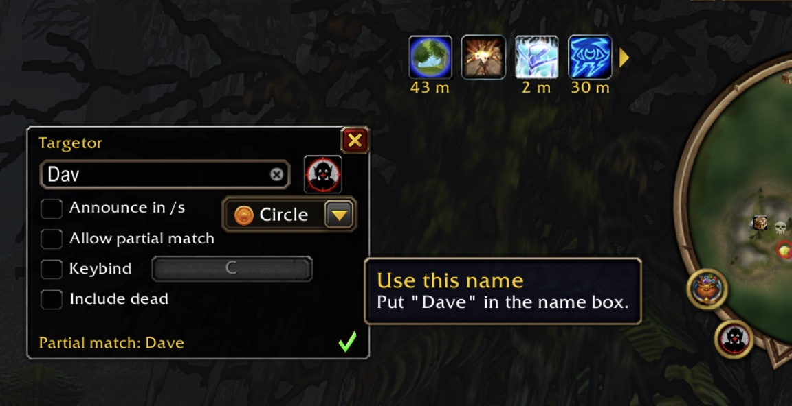
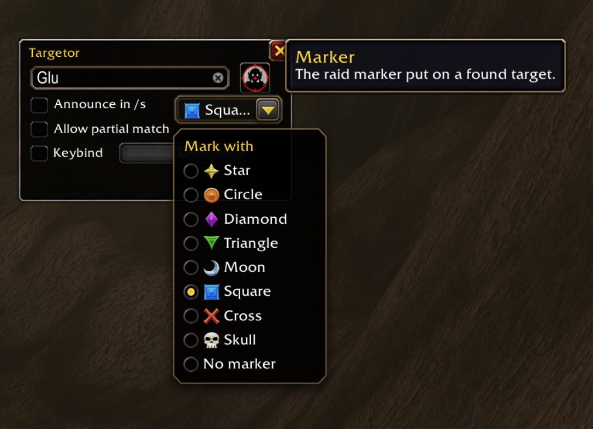
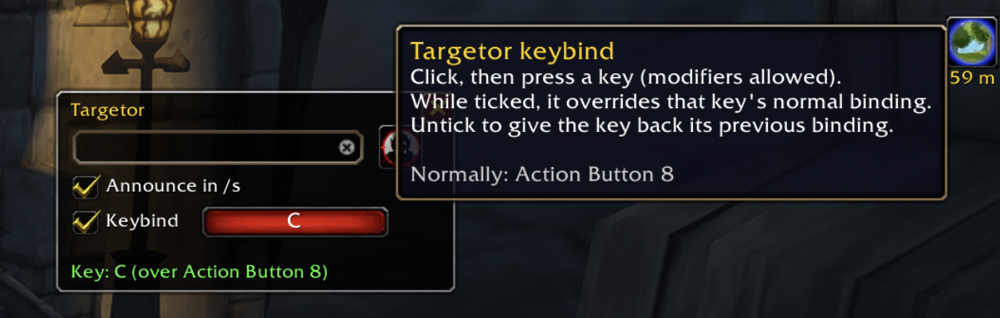
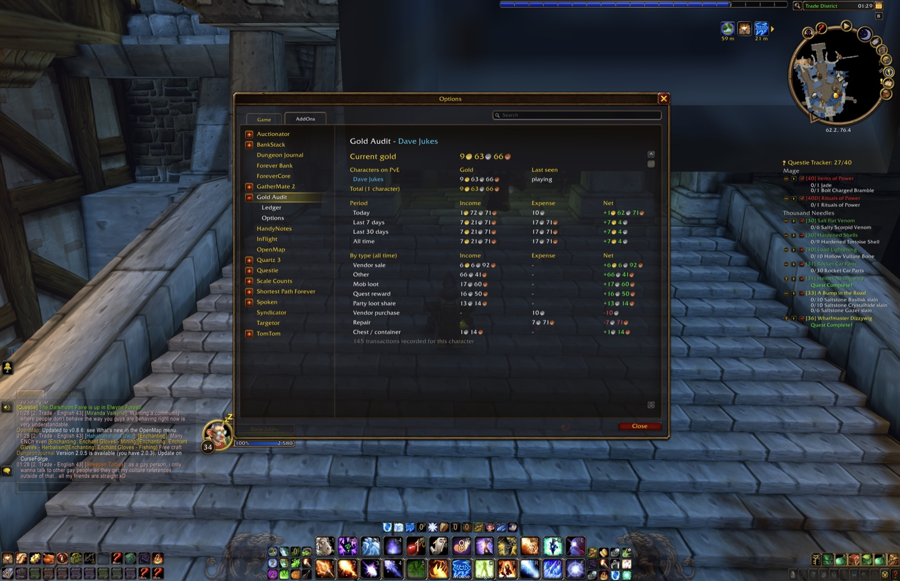
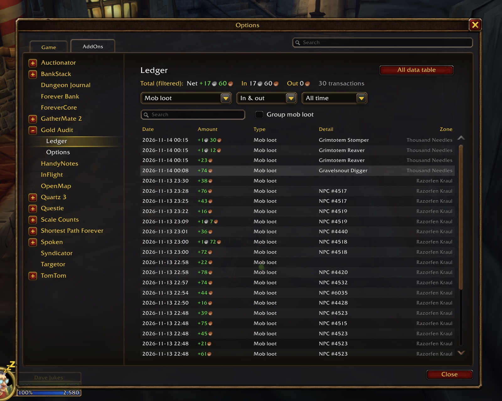
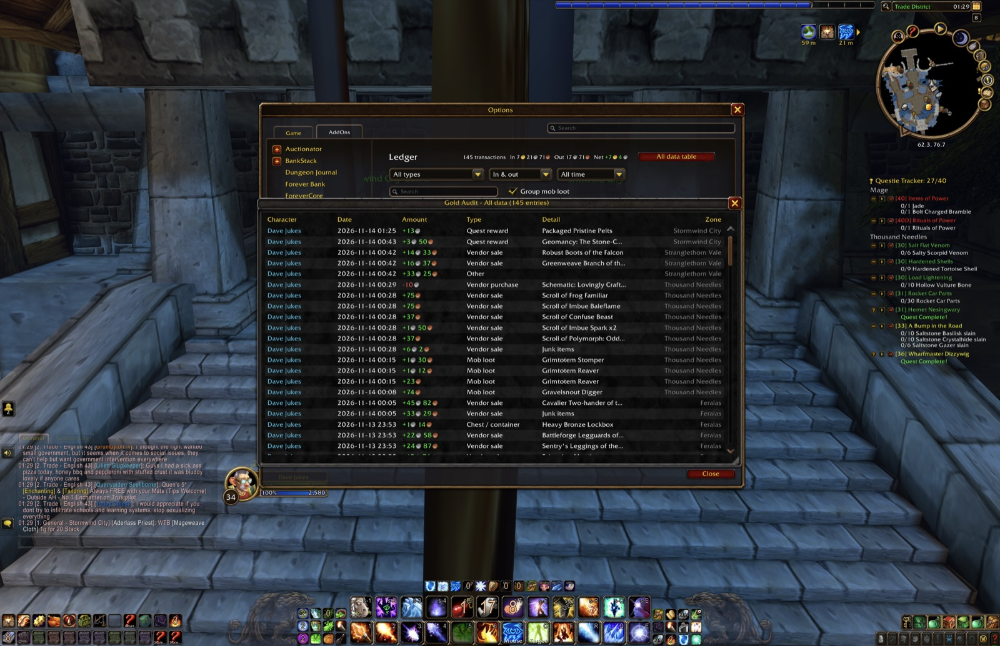

# Jukes Addons

Three small World of Warcraft addons for **Classic** clients.
They're built for and tested on the 1.x "Forever" client, and their `.toc` files also list other Classic and Retail interface versions.

| Addon | Version | What it does |
| --- | --- | --- |
| [**Targetor**](#targetor) | 1.4.0 | Type a name and click, or press your keybind, to target it. Exact matches get a raid marker of your choice (square by default) and an optional `/s` announcement. |
| [**Gold Audit**](#gold-audit) | 1.0.0 | Records every change to your gold and what caused it, with a ledger, totals and filters. |
| [**Scale Counts**](#scale-counts) | 1.0.0 | Resizes, recolours and repositions the item/reagent count on action bar buttons. |

> [!WARNING]
> **Use at your own risk.** These addons are provided "as is", without warranty of any kind. See the [MIT License](LICENSE).

## Install

1. Download a zip from the [latest release](https://github.com/David-Tennant/JukesAddons/releases/latest). `JukesAddons-all` contains all three addons.
2. Extract it into `World of Warcraft/_<version>_/Interface/AddOns/`, so that you have, for example, `Interface/AddOns/JukesTargetor/JukesTargetor.toc`.
3. Restart the game, or `/reload` if it was already running, and check the addons are enabled in the AddOns list.

The folders are prefixed with `Jukes`, but the addons show in-game as **Targetor**, **Gold Audit** and **Scale Counts**.

---

## Targetor

A small window for finding a mob or player by name.

- Type a name and click the **target icon**, or press your [keybind](#keybind).
- If a mob or player with **exactly** that name is nearby, Targetor targets it, puts your chosen raid marker on it (**square** by default), says `Found <Name>! {square}` in `/s`, and shows "Found" in the window. Capital letters don't matter.
- Click the **minimap button** to show or hide the window, and drag it to move it around the minimap. `/targetor` also toggles the window.
- The clear button empties the name box.

**On the window:**

| Option | What it does |
| --- | --- |
| Announce in /s | Turns the `/s` message on or off. Only exact matches are ever announced. |
| Marker dropdown | Picks the raid marker put on a found target: star, circle, diamond, triangle, moon, **square** (default), cross or skull, or **No marker** to only target. The `/s` message shows the same marker. |
| Allow partial match | **Off** (default): only an exact name is marked. A partial match, such as "D" finding "Darnassus Sentinel", is targeted but not marked, and the window shows **"Partial match: Darnassus Sentinel"**. **On:** a partial match is marked too, but still not announced. |
| Keybind | Lets a key do the same as clicking the target icon. See [Keybind](#keybind). |
| Include dead | **Off** (default): dead mobs and players are ignored. They aren't targeted, marked or announced, and the window shows **No living "name" nearby**. **On:** dead ones can be targeted and marked too. |

**Tick button:** after a partial match (as in the screenshot at the top), click the green **tick** to put the full name in the name box. Your next search is then an exact match, so it gets marked and announced.

An exact name always wins: if both an exact and a partial match are nearby, Targetor picks the exact one.

### Keybind

1. Tick **Keybind**. The first time, the button next to it asks you to press a key.
2. Press any key, with Shift, Ctrl or Alt if you like (for example `SHIFT-F`). Pressing that key now does the same as clicking the target icon.
3. To change the key, click the button again and press a new one. Esc cancels.
4. Untick **Keybind** to give the key back whatever it did before.

While ticked, the Targetor keybind **overrides** that key's normal binding. Targetor never changes your saved key bindings: the override sits on top of them, and unticking removes it. Hover over the key button to see what the key normally does. The key and the on/off state are remembered between sessions.

### Settings

Options → AddOns → Targetor:

| Setting | Default | |
| --- | --- | --- |
| Allow partial match | Off | The same as the checkbox on the window. |
| Announce in /s | On | The same as the checkbox on the window. |
| Marker | Square | The same as the dropdown on the window. |
| Include dead | Off | The same as the checkbox on the window. |
| Use keybind | Off | The same as the **Keybind** checkbox on the window. Choose the key on the window. |
| Window opacity | 100% | Anywhere from 5% to 100%. |

### Limits set by the game

- **Click or keybind only:** addons can only target or mark from a real mouse click or key press, so pressing Enter in the name box doesn't search. Use the keybind instead.
- **Combat:** during combat you can't change the name, the marker or the partial-match option, show or hide the window, or change the keybind. The button and the keybind still work with the settings you had before. A change made during combat applies as soon as combat ends.
- **Groups:** in a group, the raid marker needs you to be leader or assist.
- **Your target:** each search clears your current target first, so an old target isn't reported as found.
- **Range:** a search only finds mobs and players your game has loaded, roughly what you can see (about 100 yards), and it picks the nearest match first. With **Include dead** off, Targetor skips past up to six dead matches to reach a living one further away.

---

## Gold Audit

Records every change to your gold and works out why it happened: quest rewards, mob loot, vendor sales, repairs, the auction house, mail, trades, flight paths, training and more.

Open it with **`/ga`**, or from Options → AddOns → Gold Audit.

- **Summary:** current gold, your characters' gold and when you last saw each, income/expense/net by period, and totals by type.
- **Ledger:** every transaction for the current character, filtered by type, in/out, time period and text search. Mob loot can be grouped into one expandable line. The totals at the top cover only the transactions shown.

  

- **All data window:** every transaction for **every character** in a window you can move and resize. Open it with the **All data table** button on the Ledger page, or with **`/ga data`**. Its size and position are remembered.

  

- **Time periods:** Today, Last 7 days, Last 30 days, All time, or **Custom range**. Custom range has separate **date** and **time** boxes for *From* and *To*, each with step arrows. They start at your earliest and latest recorded transactions.
- **Options:** print each change to chat, group mob loot, and delete this character's history.

---

## Scale Counts

Changes how the item and reagent count looks on action bar buttons, for example how many reagents you have left for a spell.

- **Size** from 50% to 300%, **colour and opacity**, and **position** (left/centre/right, top/middle/bottom).
- Set it once for all bars, or give individual bars their own settings.
- **Resource Store:** reagent spells and consumables seen on your bars are listed here. Untick one to hide its count, or click **Forget** to remove it from the list.

  

- Also applies to Bartender4, Dominos and ElvUI bars, using the all-bars settings.

Open it from Options → AddOns → Scale Counts, or with **`/scalecounts`** (or `/srt`).

---

## License

[MIT](LICENSE) © 2026 David Tennant
